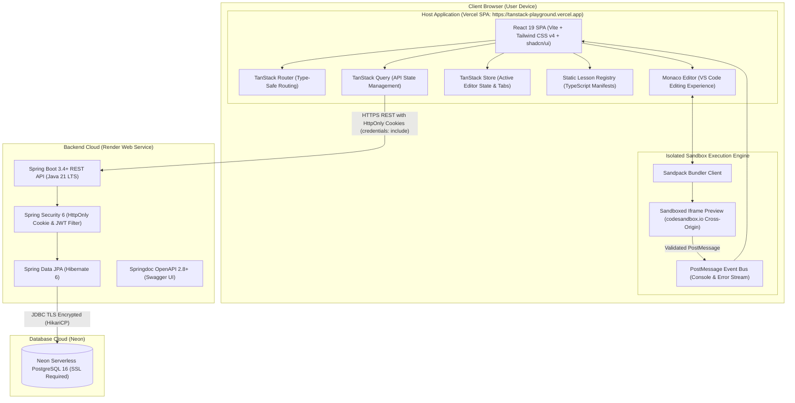
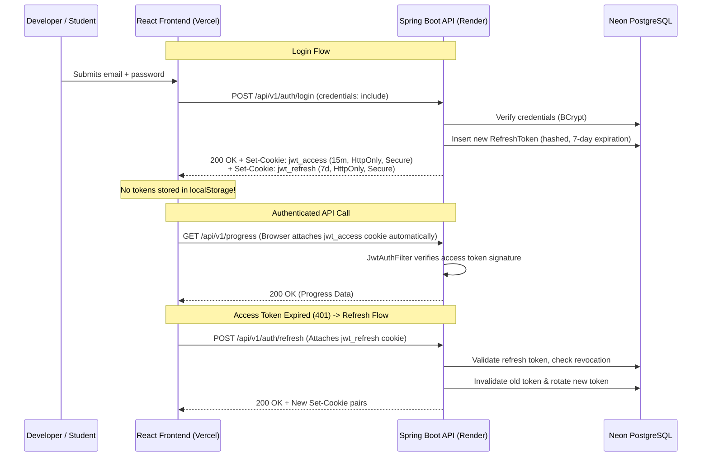

# Architecture Specification — TanStack Playground

## 1. System Overview & Core Mission

**TanStack Playground** is a production-grade, interactive learning and code experimentation platform engineered for the modern **TanStack** ecosystem. The platform enables developers to learn, edit, and execute runnable examples with instantaneous feedback.

### 1.1 Standard Terminology
Throughout the application, specifications, and codebase, the following terms are used consistently:
- **Track**: A TanStack library or ecosystem project (e.g., TanStack Query, TanStack Router, TanStack Table).
- **Lesson**: A discrete conceptual learning topic within a track (e.g., Query Basics & Caching, Column Filtering).
- **Example**: An interactive, executable, multi-file code demonstration mounted in the editor and sandbox.

### 1.2 Core Architectural Principles
- **Content Ownership Separation**: The static curriculum (library metadata, lesson explanations, learning objectives, starter code, solution code, hints, code annotations, and sandbox dependencies) is authored and maintained in **frontend TypeScript lesson manifests** as the single source of truth. PostgreSQL stores strictly dynamic and user-centric data: user accounts, session refresh tokens, learning progress, user-modified code overrides, bookmarks, user preferences, and shared playground snippets.
- **Client-Side Sandbox Isolation**: All code compilation, transpilation, and execution occurs strictly in the user's browser inside an isolated Sandpack iframe hosted on a distinct cross-origin domain. The Spring Boot backend acts as a stateless REST service and **never executes arbitrary user JavaScript**.
- **Hardened Cookie Authentication**: In production, authentication uses `HttpOnly`, `Secure` cookies with refresh token rotation. Tokens are **never stored in `localStorage`**.
- **Consistent Typing & Identifiers**: Database identifiers use PostgreSQL `BIGSERIAL` / `BIGINT`, mapped to Java `Long` in JPA entities and DTOs, and typed as `number` in TypeScript.

---

## 2. High-Level System Topology



---

## 3. Frontend Architecture (`frontend/`)

### 3.1 Technology Stack & Ecosystem Versions

| Technology | Selected Version | Role / Justification |
| :--- | :--- | :--- |
| **React** | `^19.0.0` | Core UI rendering engine with modern concurrent features |
| **TypeScript** | `^5.7.3` | Strict type safety for manifests, DTOs, and components |
| **Vite** | `^6.1.0` | Fast HMR dev server and optimized production bundler |
| **Tailwind CSS** | `^4.0.0` | Modern utility CSS framework via `@tailwindcss/vite` |
| **shadcn/ui** | Latest | Accessible Radix UI composable components |
| **Lucide React** | `^1.65.0` | Consistent vector iconography |
| **TanStack Router** | `^1.170.46` | Type-safe declarative client routing and search params |
| **TanStack Query** | `^5.105.0` | Server-state caching, optimistic updates, and queries |
| **TanStack Table** | `^8.21.2` | Headless table engine for sorting, filtering, and pagination |
| **TanStack Form** | `^1.33.5` | Reactive form state management with Zod integration |
| **TanStack Virtual**| `^3.14.24` | 60 FPS DOM virtualization for massive lists and grids |
| **TanStack Store** | `^0.11.2` | Lightweight fine-grained state store for editor workspace |
| **Monaco Editor** | `@monaco-editor/react@^4.7.0` | VS Code editing engine (syntax highlight, diff, tabs) |
| **Sandpack** | `@codesandbox/sandpack-react@^2.20.0` | Isolated browser bundler, dependency manager, preview |
| **Recharts** | `^3.10.1` | Performance metrics and memory charts |
| **Zod** | `^3.24.2` | Schema validation for user inputs and manifests |
| **Axios** | `^1.7.9` | HTTP client with `withCredentials: true` support |

---

## 4. Authentication & Deployment Architecture: HttpOnly Cookies

### 4.1 Token Lifecycle & Storage Strategy


### 4.2 Cross-Site Cookie Deployment Reality & Alternatives
When frontend (`*.vercel.app`) and backend (`*.onrender.com`) use distinct public cloud subdomains, they are **cross-site** under the Public Suffix List (PSL).
- **Default Cloud Deployment**: Cookies require `SameSite=None; Secure; Partitioned`. However, browsers with strict third-party cookie blocking (Safari ITP, Chrome Privacy Sandbox, Brave) will reject cross-site cookies.
- **Recommended Production Solution A (Unified Custom Apex Domain)**:
  - Frontend: `https://app.tanstackplayground.com`
  - Backend: `https://api.tanstackplayground.com`
  - Because both subdomains share the registered domain `tanstackplayground.com`, requests are **same-site**. Cookies use `SameSite=Lax; Secure`, completely immune to third-party cookie blocking.
- **Recommended Production Solution B (Vercel API Proxy Rewrite)**:
  - Frontend proxies `/api/v1/*` to Render backend via `vercel.json` rewrites.
  - From the browser's perspective, all API requests are **same-origin first-party** calls. Cookies use `SameSite=Lax`, completely eliminating CORS and cookie blocking.

---

## 5. Spring Security CORS Configuration

In Spring Security 6, `setAllowedOrigins` throws exceptions or fails to match when wildcards are used. To safely support Vercel preview environments, custom domains, and local development, `setAllowedOriginPatterns` is strictly configured:

```java
@Bean
public CorsConfigurationSource corsConfigurationSource() {
    CorsConfiguration configuration = new CorsConfiguration();
    configuration.setAllowedOriginPatterns(List.of(
        "https://tanstack-playground.vercel.app",
        "https://tanstack-playground-*.vercel.app",
        "https://*.tanstackplayground.com",
        "http://localhost:[*]"
    ));
    configuration.setAllowedMethods(List.of("GET", "POST", "PUT", "DELETE", "OPTIONS"));
    configuration.setAllowedHeaders(List.of(
        "Content-Type", 
        "X-Requested-With", 
        "X-CSRF-Token"
    ));
    configuration.setAllowCredentials(true);
    configuration.setMaxAge(3600L);

    UrlBasedCorsConfigurationSource source = new UrlBasedCorsConfigurationSource();
    source.registerCorsConfiguration("/api/v1/**", configuration);
    return source;
}
```

---

## 6. Code Execution & Sandpack Sandbox Security

### 6.1 True Sandpack Iframe Security Boundaries
Combining `sandbox="allow-scripts allow-same-origin"` on a **same-origin** iframe is an established security vulnerability that permits sandbox escape.

**Sandpack isolates code by hosting the bundler on an entirely separate cross-origin domain:**
1. The iframe source points to `https://sandpack-bundler.codesandbox.io` (or an isolated hash subdomain).
2. Because the bundler origin is distinct from the host origin (`tanstack-playground.vercel.app`), the browser's **Same-Origin Policy (SOP)** strictly prevents the iframe from reading host cookies, `localStorage`, or accessing `window.parent`.
3. `allow-same-origin` in this cross-origin context grants the bundler access only to its own isolated CodeSandbox worker caches, not the host application.

### 6.2 Outbound Network Requests & CORS Reality
- **CORS is not an egress firewall**: It does not stop a browser iframe from transmitting HTTP `GET` requests or image pings. CORS only restricts the script's ability to read responses from servers that do not send `Access-Control-Allow-Origin: *`.
- **Egress Mitigation**: The preview iframe operates under a strict Content Security Policy (`connect-src 'self' https://sandpack-bundler.codesandbox.io https://esm.sh https://cdn.jsdelivr.net`). For data-fetching lessons, in-memory synthetic mock functions intercept requests without generating real outbound traffic.
- **Credentialless Iframe**: The iframe executes with `credentials: 'omit'`, ensuring host session cookies are never transmitted on external requests.

### 6.3 TanStack Start: Server Functions RPC Simulator Realism
- Standard web browsers cannot run a native Node.js process, POSIX sockets, or execute live Nitro server-side rendering.
- TanStack Start lessons utilize a **Server Function RPC Simulator**. The simulator demonstrates `createServerFn` type contracts, argument validation, and server console separation. It does **not** execute live Node.js/Nitro SSR.

---

## 7. Content Ownership & Separation Matrix

| Content / Data Entity | Source of Truth | Storage Medium | Justification |
| :--- | :--- | :--- | :--- |
| **Track Metadata & Catalog** | Frontend | TypeScript (`src/content/registry.ts`) | Zero-latency instant loading, offline navigation |
| **Lesson Explanations & Markdown**| Frontend | TypeScript (`src/content/<track>/*.ts`) | Versioned in Git, zero database query overhead |
| **Learning Objectives & Hints** | Frontend | TypeScript (`src/content/<track>/*.ts`) | Bound directly to curriculum manifests |
| **Starter & Solution Code** | Frontend | TypeScript (`src/content/<track>/*.ts`) | Fast bundling, multi-file code templates in Git |
| **Sandbox Dependencies** | Frontend | TypeScript (`sandpackConfig`) | Custom package manifests per lesson |
| **User Accounts & Credentials** | Backend | Neon PostgreSQL (`users`) | Secure identity management & password hashing |
| **Session Refresh Tokens** | Backend | Neon PostgreSQL (`refresh_tokens`)| Refresh token rotation & instant revocation |
| **User Learning Progress** | Backend | Neon PostgreSQL (`user_lesson_progress`)| Tracks completion status across devices |
| **User Code Overrides** | Backend | Neon PostgreSQL (`saved_files` JSONB) | Preserves user edits across browser sessions |
| **User Bookmarks** | Backend | Neon PostgreSQL (`user_bookmarks`) | Synchronized bookmarks for quick reference |
| **User Preferences** | Backend | Neon PostgreSQL (`user_preferences`) | Persists editor font, theme, keybindings |
| **Shared Playground Snippets** | Backend | Neon PostgreSQL (`code_snippets`) | Community playground sharing via permalinks |

---

## 8. Architectural Decision Log

| Issue | Decision | Reason | Remaining Limitation |
| :--- | :--- | :--- | :--- |
| **Cross-Site Cookie Blocking** | Support Vercel API rewrite proxy and unified custom apex domain (`tanstackplayground.com`). | Default cross-site cookies between `*.vercel.app` and `*.onrender.com` are blocked by Safari ITP and Brave by default. | Initial free tier without custom domain requires Vercel rewrites or cross-site cookie permissions. |
| **Sandpack Iframe Isolation** | Rely on Sandpack's external bundler origin (`codesandbox.io`) for SOP isolation. | `allow-scripts allow-same-origin` is unsafe only on same-origin iframes. Cross-origin domain guarantees host cookie and DOM protection. | Requires internet connectivity to reach Sandpack bundler CDN on initial load. |
| **Wildcard CORS in Spring** | Replace `setAllowedOrigins` with `setAllowedOriginPatterns`. | Spring Security 6 throws runtime errors when wildcards are passed to `setAllowedOrigins`. | None; origin patterns match preview branches cleanly. |
| **Outbound Sandbox Egress** | Acknowledge CORS is a read barrier, not an egress firewall; enforce CSP `connect-src`. | Prevents misrepresenting browser security to users while mitigating egress via CSP. | Untrusted scripts can still issue opaque GET requests to unblocked domains. |
| **Lesson Routing Ambiguity** | Enforce global uniqueness on `lessons.slug` in PostgreSQL (`UNIQUE(slug)`). | Allows `/api/v1/progress/{lessonSlug}` to resolve unambiguously while preserving `/tracks/{trackSlug}/lessons/{lessonSlug}` hierarchy. | Lesson slugs must be prefixed/namespaced (e.g. `query-basics`, `table-sorting`). |
| **List Pagination Uniformity** | Enforce Spring Data `Page<T>` JSON envelope on all paginated collections. | Standardizes frontend query logic and client pagination adapters. | Static 13-track catalog remains a direct unpaginated array. |
| **Path Traversal in VFS** | Apply regex `^/(?!.*\.\.)(?!.*//)[a-zA-Z0-9_\-\.]+(/[a-zA-Z0-9_\-\.]+)*$`. | Prevents directory traversal (`..`) and empty segments (`//`) in JSONB saved files. | File names are limited to alphanumeric, periods, underscores, and dashes. |
| **JSON Payload Size Limits** | Enforce via Tomcat `max-http-form-post-size: 524288` and Jackson stream constraints. | `spring.servlet.multipart.max-request-size` does not apply to JSON REST payloads. | Any single saved code payload exceeding 512 KB is rejected with HTTP 413. |
| **TanStack Start Realism** | Implement Client Server Function RPC Simulator with explicit disclaimer. | Browser Sandpack cannot execute native Node.js / Nitro SSR processes. | Demonstrates `createServerFn` type API and logging, but not true server SSR. |
