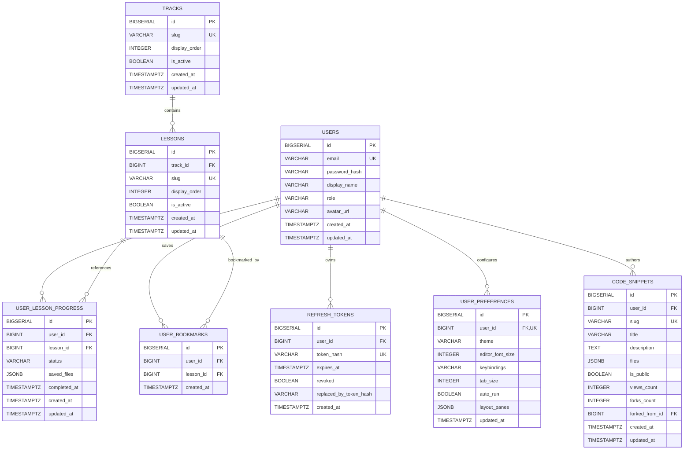

# Database Design Specification — TanStack Playground

## 1. Engine & Design Principles

- **Engine**: PostgreSQL 16+ hosted on **Neon Serverless**.
- **Driver**: PostgreSQL JDBC Driver (`org.postgresql:postgresql:42.7.5`) with HikariCP.
- **Identifier Consistency**: All surrogate primary keys use `BIGSERIAL` (PostgreSQL `BIGINT` 64-bit integer), mapped to `Long` in Java / JPA entities and DTOs, and `number` in TypeScript interfaces.
- **Content Ownership Separation**:
  - Full lesson markdown, learning objectives, hints, starter code, and Sandpack dependencies reside strictly in frontend TypeScript manifests.
  - The `tracks` and `lessons` tables serve as lightweight referential entities storing canonical slugs, display ordering, and active flags.
- **Global Lesson Slug Uniqueness**:
  - `lessons.slug` is enforced as **globally unique** (`UNIQUE (slug)`) across the entire platform (e.g., `query-basics`, `table-sorting`).
  - This eliminates any routing ambiguity between `/api/v1/tracks/{trackSlug}/lessons/{lessonSlug}` and `/api/v1/progress/{lessonSlug}`.
- **Strict Size Limits & Traversal Prevention**:
  - Saved code payloads (`saved_files` and `files` in `JSONB`) are restricted to a maximum of **500 KB** per payload and **25 files** per virtual file system tree.
  - File paths must match the hardened regex `^/(?!.*\.\.)(?!.*//)[a-zA-Z0-9_\-\.]+(/[a-zA-Z0-9_\-\.]+)*$`, rejecting traversal segments (`..`) and double slashes (`//`).

---

## 2. Entity-Relationship Diagram (ERD)



---

## 3. Relational Table Specifications

### 3.1 `users`
| Column | PostgreSQL Type | Constraints | Description |
| :--- | :--- | :--- | :--- |
| `id` | `BIGSERIAL` | `PRIMARY KEY` | Surrogate 64-bit identifier |
| `email` | `VARCHAR(255)` | `NOT NULL, UNIQUE` | Unique email for authentication |
| `password_hash` | `VARCHAR(255)` | `NOT NULL` | BCrypt password hash (work factor 12) |
| `display_name` | `VARCHAR(100)` | `NOT NULL` | Public user handle / display name |
| `role` | `VARCHAR(30)` | `NOT NULL DEFAULT 'ROLE_USER'` | Access role: `ROLE_USER`, `ROLE_ADMIN` |
| `avatar_url` | `VARCHAR(512)` | `NULL` | Optional profile image URL |
| `created_at` | `TIMESTAMPTZ` | `NOT NULL DEFAULT CURRENT_TIMESTAMP` | Account creation timestamp |
| `updated_at` | `TIMESTAMPTZ` | `NOT NULL DEFAULT CURRENT_TIMESTAMP` | Last profile modification timestamp |

---

### 3.2 `refresh_tokens`
| Column | PostgreSQL Type | Constraints | Description |
| :--- | :--- | :--- | :--- |
| `id` | `BIGSERIAL` | `PRIMARY KEY` | Surrogate identifier |
| `user_id` | `BIGINT` | `NOT NULL, REFERENCES users(id) ON DELETE CASCADE` | Associated user account |
| `token_hash` | `VARCHAR(255)` | `NOT NULL, UNIQUE` | SHA-256 hash of the refresh token UUID |
| `expires_at` | `TIMESTAMPTZ` | `NOT NULL` | Expiration timestamp (7 days from issue) |
| `revoked` | `BOOLEAN` | `NOT NULL DEFAULT FALSE` | Flag indicating if token is revoked |
| `replaced_by_token_hash`| `VARCHAR(255)`| `NULL` | Hash of successor token (reuse detection) |
| `created_at` | `TIMESTAMPTZ` | `NOT NULL DEFAULT CURRENT_TIMESTAMP` | Token generation timestamp |

---

### 3.3 `tracks`
| Column | PostgreSQL Type | Constraints | Description |
| :--- | :--- | :--- | :--- |
| `id` | `BIGSERIAL` | `PRIMARY KEY` | Surrogate identifier |
| `slug` | `VARCHAR(60)` | `NOT NULL, UNIQUE` | Canonical track slug (e.g. `query`, `table`) |
| `display_order` | `INTEGER` | `NOT NULL DEFAULT 0` | Catalog display order |
| `is_active` | `BOOLEAN` | `NOT NULL DEFAULT TRUE` | Active visibility flag |
| `created_at` | `TIMESTAMPTZ` | `NOT NULL DEFAULT CURRENT_TIMESTAMP` | Creation timestamp |
| `updated_at` | `TIMESTAMPTZ` | `NOT NULL DEFAULT CURRENT_TIMESTAMP` | Last update timestamp |

---

### 3.4 `lessons`
| Column | PostgreSQL Type | Constraints | Description |
| :--- | :--- | :--- | :--- |
| `id` | `BIGSERIAL` | `PRIMARY KEY` | Surrogate identifier |
| `track_id` | `BIGINT` | `NOT NULL, REFERENCES tracks(id) ON DELETE CASCADE` | Parent track reference |
| `slug` | `VARCHAR(100)` | `NOT NULL, UNIQUE` | **Globally unique** lesson slug |
| `display_order` | `INTEGER` | `NOT NULL DEFAULT 0` | Display order within track |
| `is_active` | `BOOLEAN` | `NOT NULL DEFAULT TRUE` | Active visibility flag |
| `created_at` | `TIMESTAMPTZ` | `NOT NULL DEFAULT CURRENT_TIMESTAMP` | Creation timestamp |
| `updated_at` | `TIMESTAMPTZ` | `NOT NULL DEFAULT CURRENT_TIMESTAMP` | Last update timestamp |

*Constraints*: `UNIQUE (slug)` globally, and `UNIQUE (track_id, slug)` composite index.

---

### 3.5 `user_lesson_progress`
| Column | PostgreSQL Type | Constraints | Description |
| :--- | :--- | :--- | :--- |
| `id` | `BIGSERIAL` | `PRIMARY KEY` | Surrogate identifier |
| `user_id` | `BIGINT` | `NOT NULL, REFERENCES users(id) ON DELETE CASCADE` | Associated user account |
| `lesson_id` | `BIGINT` | `NOT NULL, REFERENCES lessons(id) ON DELETE CASCADE` | Associated lesson reference |
| `status` | `VARCHAR(20)` | `NOT NULL DEFAULT 'IN_PROGRESS'` | `NOT_STARTED`, `IN_PROGRESS`, `COMPLETED` |
| `saved_files` | `JSONB` | `NULL` | Student's modified VFS code (max 500 KB) |
| `completed_at` | `TIMESTAMPTZ` | `NULL` | Timestamp when user marked completed |
| `created_at` | `TIMESTAMPTZ` | `NOT NULL DEFAULT CURRENT_TIMESTAMP` | Initial progress record creation |
| `updated_at` | `TIMESTAMPTZ` | `NOT NULL DEFAULT CURRENT_TIMESTAMP` | Last progress or code update |

*Composite Unique Constraint*: `UNIQUE (user_id, lesson_id)`

---

### 3.6 `user_preferences`
| Column | PostgreSQL Type | Constraints | Description |
| :--- | :--- | :--- | :--- |
| `id` | `BIGSERIAL` | `PRIMARY KEY` | Surrogate identifier |
| `user_id` | `BIGINT` | `NOT NULL, UNIQUE, REFERENCES users(id) ON DELETE CASCADE` | 1-to-1 relationship with user |
| `theme` | `VARCHAR(20)` | `NOT NULL DEFAULT 'dark'` | UI theme: `light`, `dark`, `system` |
| `editor_font_size`| `INTEGER` | `NOT NULL DEFAULT 14` | Monaco editor font size (10 - 24) |
| `keybindings` | `VARCHAR(20)` | `NOT NULL DEFAULT 'standard'` | `standard`, `vim`, `vscode` |
| `tab_size` | `INTEGER` | `NOT NULL DEFAULT 2` | Indentation spaces (2 or 4) |
| `auto_run` | `BOOLEAN` | `NOT NULL DEFAULT TRUE` | Auto-refresh preview on code change |
| `layout_panes` | `JSONB` | `NULL` | Resizable panel percentage widths |
| `updated_at` | `TIMESTAMPTZ` | `NOT NULL DEFAULT CURRENT_TIMESTAMP` | Last update timestamp |

---

### 3.7 `user_bookmarks`
| Column | PostgreSQL Type | Constraints | Description |
| :--- | :--- | :--- | :--- |
| `id` | `BIGSERIAL` | `PRIMARY KEY` | Surrogate identifier |
| `user_id` | `BIGINT` | `NOT NULL, REFERENCES users(id) ON DELETE CASCADE` | User who saved the bookmark |
| `lesson_id` | `BIGINT` | `NOT NULL, REFERENCES lessons(id) ON DELETE CASCADE` | Bookmarked lesson |
| `created_at` | `TIMESTAMPTZ` | `NOT NULL DEFAULT CURRENT_TIMESTAMP` | Timestamp of bookmarking |

*Composite Unique Constraint*: `UNIQUE (user_id, lesson_id)`

---

### 3.8 `code_snippets`
| Column | PostgreSQL Type | Constraints | Description |
| :--- | :--- | :--- | :--- |
| `id` | `BIGSERIAL` | `PRIMARY KEY` | Surrogate identifier |
| `user_id` | `BIGINT` | `NOT NULL, REFERENCES users(id) ON DELETE CASCADE` | Creator of snippet |
| `slug` | `VARCHAR(32)` | `NOT NULL, UNIQUE` | URL-safe nanoid identifier (e.g. `tnsk-8k2p1m`) |
| `title` | `VARCHAR(160)` | `NOT NULL` | Playground title |
| `description` | `TEXT` | `NULL` | Optional summary description |
| `files` | `JSONB` | `NOT NULL` | Virtual file tree (max 500 KB, max 25 files) |
| `is_public` | `BOOLEAN` | `NOT NULL DEFAULT TRUE` | Visibility flag |
| `views_count` | `INTEGER` | `NOT NULL DEFAULT 0` | View counter |
| `forks_count` | `INTEGER` | `NOT NULL DEFAULT 0` | Number of times forked |
| `forked_from_id` | `BIGINT` | `NULL, REFERENCES code_snippets(id) ON DELETE SET NULL` | Parent snippet if forked |
| `created_at` | `TIMESTAMPTZ` | `NOT NULL DEFAULT CURRENT_TIMESTAMP` | Record creation timestamp |
| `updated_at` | `TIMESTAMPTZ` | `NOT NULL DEFAULT CURRENT_TIMESTAMP` | Last modification timestamp |

---

## 4. Virtual File System `JSONB` Schema & Validation Invariants

```json
{
  "/App.tsx": {
    "code": "import React from 'react';\n\nexport default function App() {\n  return <h1>Hello TanStack</h1>;\n}",
    "active": true
  },
  "/api.ts": {
    "code": "export async function getItems() { return []; }",
    "active": false
  }
}
```

### Invariants Enforced in Application Layer & Database
1. **Total Payload Size**: Maximum `524,288` characters (512 KB), enforced at Tomcat layer (`server.tomcat.max-http-form-post-size=524288`) and Jackson stream constraint (`StreamReadConstraints.maxStringLength(524288)`).
2. **File Count**: Maximum `25` keys per JSON object.
3. **Hardened File Path Regex**: `^/(?!.*\.\.)(?!.*//)[a-zA-Z0-9_\-\.]+(/[a-zA-Z0-9_\-\.]+)*$`
   - Rejects traversal sequences (`..`).
   - Rejects empty/double slash segments (`//`).
   - Requires leading slash `/`.

---

## 5. Indexing & Query Optimization Strategy

| Index Name | Target Table | Indexed Columns | Index Type | Purpose |
| :--- | :--- | :--- | :--- | :--- |
| `idx_users_email` | `users` | `email` | B-Tree (Unique) | O(1) login lookup |
| `idx_refresh_tokens_hash`| `refresh_tokens`| `token_hash` | B-Tree (Unique) | Fast refresh verification |
| `idx_refresh_tokens_user`| `refresh_tokens`| `user_id` | B-Tree | Cascade revocation & cleanup |
| `idx_tracks_slug` | `tracks` | `slug` | B-Tree (Unique) | Track resolution |
| `idx_lessons_slug` | `lessons` | `slug` | B-Tree (Unique) | Global lesson resolution |
| `idx_lessons_track_slug` | `lessons` | `track_id, slug` | B-Tree | Hierarchical lookups |
| `idx_progress_user_lesson`| `user_lesson_progress`| `user_id, lesson_id` | B-Tree (Unique) | Progress status check |
| `idx_progress_user` | `user_lesson_progress`| `user_id, status` | B-Tree | Progress summary queries |
| `idx_bookmarks_user` | `user_bookmarks` | `user_id, created_at DESC`| B-Tree | Bookmarks list |
| `idx_snippets_slug` | `code_snippets` | `slug` | B-Tree (Unique) | Permalink snippet lookup |
| `idx_snippets_user` | `code_snippets` | `user_id, created_at DESC`| B-Tree | Personal snippet portfolio |

---

## 6. Neon Serverless Configuration & HikariCP

- **Connection URL**:
  ```properties
  spring.datasource.url=jdbc:postgresql://<neon-hostname>/tanstack_playground?sslmode=require
  ```
- **Connection Pool Settings**:
  - `spring.datasource.hikari.maximum-pool-size=10`
  - `spring.datasource.hikari.minimum-idle=2`
  - `spring.datasource.hikari.idle-timeout=30000`
  - `spring.datasource.hikari.max-lifetime=1800000`
  - `spring.datasource.hikari.connection-timeout=20000`

---

## 7. Migration DDL Script (`V1__initial_schema.sql`)

```sql
-- V1__initial_schema.sql
-- TanStack Playground Database Initialization

CREATE TABLE users (
    id BIGSERIAL PRIMARY KEY,
    email VARCHAR(255) NOT NULL UNIQUE,
    password_hash VARCHAR(255) NOT NULL,
    display_name VARCHAR(100) NOT NULL,
    role VARCHAR(30) NOT NULL DEFAULT 'ROLE_USER',
    avatar_url VARCHAR(512),
    created_at TIMESTAMPTZ NOT NULL DEFAULT CURRENT_TIMESTAMP,
    updated_at TIMESTAMPTZ NOT NULL DEFAULT CURRENT_TIMESTAMP
);

CREATE TABLE refresh_tokens (
    id BIGSERIAL PRIMARY KEY,
    user_id BIGINT NOT NULL REFERENCES users(id) ON DELETE CASCADE,
    token_hash VARCHAR(255) NOT NULL UNIQUE,
    expires_at TIMESTAMPTZ NOT NULL,
    revoked BOOLEAN NOT NULL DEFAULT FALSE,
    replaced_by_token_hash VARCHAR(255),
    created_at TIMESTAMPTZ NOT NULL DEFAULT CURRENT_TIMESTAMP
);

CREATE TABLE tracks (
    id BIGSERIAL PRIMARY KEY,
    slug VARCHAR(60) NOT NULL UNIQUE,
    display_order INTEGER NOT NULL DEFAULT 0,
    is_active BOOLEAN NOT NULL DEFAULT TRUE,
    created_at TIMESTAMPTZ NOT NULL DEFAULT CURRENT_TIMESTAMP,
    updated_at TIMESTAMPTZ NOT NULL DEFAULT CURRENT_TIMESTAMP
);

CREATE TABLE lessons (
    id BIGSERIAL PRIMARY KEY,
    track_id BIGINT NOT NULL REFERENCES tracks(id) ON DELETE CASCADE,
    slug VARCHAR(100) NOT NULL UNIQUE,
    display_order INTEGER NOT NULL DEFAULT 0,
    is_active BOOLEAN NOT NULL DEFAULT TRUE,
    created_at TIMESTAMPTZ NOT NULL DEFAULT CURRENT_TIMESTAMP,
    updated_at TIMESTAMPTZ NOT NULL DEFAULT CURRENT_TIMESTAMP,
    CONSTRAINT uq_track_lesson_slug UNIQUE (track_id, slug)
);

CREATE TABLE user_lesson_progress (
    id BIGSERIAL PRIMARY KEY,
    user_id BIGINT NOT NULL REFERENCES users(id) ON DELETE CASCADE,
    lesson_id BIGINT NOT NULL REFERENCES lessons(id) ON DELETE CASCADE,
    status VARCHAR(20) NOT NULL DEFAULT 'IN_PROGRESS',
    saved_files JSONB,
    completed_at TIMESTAMPTZ,
    created_at TIMESTAMPTZ NOT NULL DEFAULT CURRENT_TIMESTAMP,
    updated_at TIMESTAMPTZ NOT NULL DEFAULT CURRENT_TIMESTAMP,
    CONSTRAINT uq_user_lesson_progress UNIQUE (user_id, lesson_id)
);

CREATE TABLE user_preferences (
    id BIGSERIAL PRIMARY KEY,
    user_id BIGINT NOT NULL UNIQUE REFERENCES users(id) ON DELETE CASCADE,
    theme VARCHAR(20) NOT NULL DEFAULT 'dark',
    editor_font_size INTEGER NOT NULL DEFAULT 14,
    keybindings VARCHAR(20) NOT NULL DEFAULT 'standard',
    tab_size INTEGER NOT NULL DEFAULT 2,
    auto_run BOOLEAN NOT NULL DEFAULT TRUE,
    layout_panes JSONB,
    updated_at TIMESTAMPTZ NOT NULL DEFAULT CURRENT_TIMESTAMP
);

CREATE TABLE user_bookmarks (
    id BIGSERIAL PRIMARY KEY,
    user_id BIGINT NOT NULL REFERENCES users(id) ON DELETE CASCADE,
    lesson_id BIGINT NOT NULL REFERENCES lessons(id) ON DELETE CASCADE,
    created_at TIMESTAMPTZ NOT NULL DEFAULT CURRENT_TIMESTAMP,
    CONSTRAINT uq_user_lesson_bookmark UNIQUE (user_id, lesson_id)
);

CREATE TABLE code_snippets (
    id BIGSERIAL PRIMARY KEY,
    user_id BIGINT NOT NULL REFERENCES users(id) ON DELETE CASCADE,
    slug VARCHAR(32) NOT NULL UNIQUE,
    title VARCHAR(160) NOT NULL,
    description TEXT,
    files JSONB NOT NULL,
    is_public BOOLEAN NOT NULL DEFAULT TRUE,
    views_count INTEGER NOT NULL DEFAULT 0,
    forks_count INTEGER NOT NULL DEFAULT 0,
    forked_from_id BIGINT REFERENCES code_snippets(id) ON DELETE SET NULL,
    created_at TIMESTAMPTZ NOT NULL DEFAULT CURRENT_TIMESTAMP,
    updated_at TIMESTAMPTZ NOT NULL DEFAULT CURRENT_TIMESTAMP
);

-- Optimization Indexes
CREATE INDEX idx_refresh_tokens_user ON refresh_tokens(user_id);
CREATE INDEX idx_tracks_order ON tracks(display_order ASC);
CREATE INDEX idx_lessons_track_order ON lessons(track_id, display_order ASC);
CREATE INDEX idx_progress_user ON user_lesson_progress(user_id, status);
CREATE INDEX idx_bookmarks_user ON user_bookmarks(user_id, created_at DESC);
CREATE INDEX idx_snippets_user ON code_snippets(user_id, created_at DESC);
```
