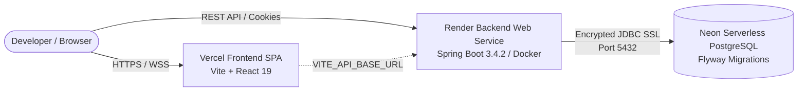

# Production Deployment Guide — TanStack Playground

This guide provides end-to-end instructions for deploying the **TanStack Playground** full-stack platform across **Neon PostgreSQL**, **Render** (Spring Boot Backend), and **Vercel** (React 19 Vite Frontend).

---

## 1. Production Topology & Architecture



| Component | Provider | Hosting Model | Key Configuration |
| :--- | :--- | :--- | :--- |
| **Database** | Neon | Serverless PostgreSQL 16 | SSL Required (`sslmode=require`), HikariCP tuned for scale-to-zero |
| **Backend** | Render | Docker Container / Java 21 | Spring Boot `prod` profile, `/actuator/health` probes |
| **Frontend** | Vercel | Static Edge CDN (SPA) | Vite build (`dist`), `vercel.json` SPA route rewrites |

---

## 2. Neon PostgreSQL Configuration

Neon provides serverless PostgreSQL with instant scale-to-zero compute.

### Step 2.1: Create Neon Project & Database
1. Log in to [Neon Console](https://console.neon.tech/).
2. Click **New Project**:
   * **Project Name**: `tanstack-playground`
   * **Postgres Version**: `16` (or latest)
   * **Region**: Choose the region closest to your Render deployment (e.g., `US East (N. Virginia)` / `us-east-2`).
3. Neon will automatically provision a primary database called `neondb` and display your connection credentials.

### Step 2.2: Extract Connection Parameters
Under your Neon Dashboard > **Connection Details**:
* Select **JDBC** format. The connection URL will appear as:
  ```
  jdbc:postgresql://ep-summer-sunset-a5xxxxxx.us-east-2.aws.neon.tech/neondb?sslmode=require
  ```
* Note down:
  * **Database Host**: `ep-summer-sunset-a5xxxxxx.us-east-2.aws.neon.tech`
  * **Database Name**: `neondb`
  * **Username**: `neondb_owner` (or generated user)
  * **Password**: `[YOUR_NEON_PASSWORD]`
  * **SSL Mode**: Must always include `sslmode=require`

### Step 2.3: Connection Pooling Invariants for Neon
Neon terminates idle backend connections after approximately 5 minutes when scaling down compute. The Spring Boot backend's `application-prod.yml` includes HikariCP tuning:
* `hikari.idle-timeout: 30000` (30 seconds: drops idle connections quickly)
* `hikari.max-lifetime: 600000` (10 minutes: refreshes pool connections before serverless boundaries)
* `hikari.minimum-idle: 2`
* `hikari.maximum-pool-size: 10`
* `hikari.connection-timeout: 20000` (20 seconds: allows cold Neon computes to spin up)

### Step 2.4: Flyway Migrations
Database tables are automatically migrated on Spring Boot startup:
* `V1__initial_schema.sql`: Creates `libraries`, `topics`, `topic_contents`, `examples`, `example_files`, `users`, `user_progress`, `bookmarks`, and `user_preferences`.
* `V2__seed_metadata.sql`: Seeds curriculum topic entries, default credentials, and metadata.
No manual SQL execution is required.

---

## 3. Render Backend Deployment

The backend runs as a containerized Spring Boot service via the provided multi-stage `backend/Dockerfile`.

### Option A: 1-Click Render Blueprint (Recommended)
The repository contains a [`render.yaml`](../render.yaml) file at the root.
1. In [Render Dashboard](https://dashboard.render.com/), click **New** > **Blueprint**.
2. Connect your Git repository.
3. Render will detect `render.yaml` and prompt for the secret environment variables (`SPRING_DATASOURCE_URL`, `SPRING_DATASOURCE_USERNAME`, `SPRING_DATASOURCE_PASSWORD`).
4. Click **Apply**.

### Option B: Manual Web Service Setup
1. In [Render Dashboard](https://dashboard.render.com/), click **New** > **Web Service**.
2. Connect your GitHub repository.
3. Configure the service settings:
   * **Name**: `tanstack-playground-backend`
   * **Language / Runtime**: `Docker`
   * **Root Directory**: Leave blank (uses repo root)
   * **Dockerfile Path**: `backend/Dockerfile`
   * **Docker Context**: `backend`
   * **Instance Type**: `Free` (or `Starter`)
   * **Region**: Same region as Neon (e.g., `Oregon` or `Ohio`)
   * **Health Check Path**: `/actuator/health`

4. Add the following **Environment Variables**:

| Variable | Recommended Value / Description | Sensitive? |
| :--- | :--- | :--- |
| `SPRING_PROFILES_ACTIVE` | `prod` | No |
| `PORT` | `8080` | No |
| `SPRING_DATASOURCE_URL` | `jdbc:postgresql://<neon-host>/neondb?sslmode=require` | Yes |
| `SPRING_DATASOURCE_USERNAME` | `<neon-username>` | Yes |
| `SPRING_DATASOURCE_PASSWORD` | `<neon-password>` | Yes |
| `JWT_SECRET` | Generate a 64+ char random hex string (e.g. `openssl rand -hex 32`) | Yes |
| `CORS_ALLOWED_ORIGINS` | `https://tanstack-playground.vercel.app,http://localhost:5173` | No |

5. Click **Create Web Service**.

### Free-Tier Cold Starts & Availability Notice
> [!NOTE]
> Render free web services spin down after 15 minutes of inactivity. When a request arrives, the service experiences a **cold start of 40–60 seconds**.
> * The public health check endpoint `/actuator/health` can be pinged by UptimeRobot or Cron to keep the service warm if desired.
> * The frontend gracefully handles offline states: if the backend is spinning up or unreachable, users can continue editing code, running Sandpack examples, and exploring lessons in **Anonymous Guest Mode**.

---

## 4. Vercel Frontend Deployment

The frontend is an optimized Single Page Application (SPA) built with React 19, TanStack Router, Monaco Editor, and Sandpack.

### Step 4.1: Import into Vercel
1. Log in to [Vercel Dashboard](https://vercel.com/).
2. Click **Add New...** > **Project**.
3. Import your GitHub repository: `TanStack-Playground`.
4. Configure Project Settings:
   * **Framework Preset**: `Vite`
   * **Root Directory**: `frontend`
   * **Build Command**: `npm run build`
   * **Output Directory**: `dist`
   * **Install Command**: `npm install`

### Step 4.2: Set Environment Variables
In the **Environment Variables** section, add:

| Name | Value | Target Environments |
| :--- | :--- | :--- |
| `VITE_API_BASE_URL` | `https://tanstack-playground-backend.onrender.com` | Production, Preview, Development |

> [!IMPORTANT]
> Do NOT append a trailing slash. If left empty, the frontend defaults to relative `/api` calls (which works locally with Vite dev server proxy).

### Step 4.3: Deploy & Verify SPA Rewrites
1. Click **Deploy**. Vercel will build and assign a production URL (e.g., `https://tanstack-playground.vercel.app`).
2. SPA route rewrites are handled by [`frontend/vercel.json`](../frontend/vercel.json):
   ```json
   {
     "rewrites": [
       { "source": "/(.*)", "destination": "/index.html" }
     ]
   }
   ```
   This guarantees that navigating directly to nested URLs (such as `/library/query/query-basics` or `/progress`) or refreshing the page resolves without 404 errors.

---

## 5. End-to-End Production Verification Checklist

Run through this smoke test checklist to verify production stability:

- [ ] **1. Public Health Check**:
  Visit `https://tanstack-playground-backend.onrender.com/actuator/health`.
  Expected response:
  ```json
  {"status":"UP"}
  ```
- [ ] **2. Frontend Entry**:
  Visit your Vercel URL `https://tanstack-playground.vercel.app`. The dashboard loads with all 13 TanStack library cards and metadata.
- [ ] **3. Global Command Palette (`Ctrl+K` / `Cmd+K`)**:
  Click the top search bar or press `Ctrl+K`. Type `table sorting`. Confirm matching lessons and APIs appear; pressing Enter navigates to the lesson.
- [ ] **4. Interactive Lesson & Sandpack Preview**:
  Navigate to `/library/query/query-basics`.
  * Monaco editor renders syntax-highlighted TypeScript.
  * Live Preview renders the simulated engineering team with interactive delay/error controls.
  * Modifying code in Monaco automatically updates the preview output.
- [ ] **5. User Registration & Authentication**:
  * Click **Sign In** in the top navigation bar.
  * Click **Sign up free** and register a new test user (`prod_test@domain.com`).
  * Verify account creation succeeds, JWT token is issued, and user avatar displays in the top navigation bar.
- [ ] **6. Progress & Bookmark Persistence**:
  * Mark a topic as completed or toggle the bookmark button.
  * Navigate to `/progress` and `/bookmarks`. Verify the changes are persisted from Neon PostgreSQL.
- [ ] **7. Browser Refresh on Nested Routes**:
  Refresh the browser while on `/library/query/query-basics`. The page must re-render without a Vercel 404.
- [ ] **8. Security Audit**:
  Inspect browser Network tab and compiled bundle assets. Verify that no database credentials (`SPRING_DATASOURCE_PASSWORD`), JWT signing secrets, or private environment variables are bundled in client code.

