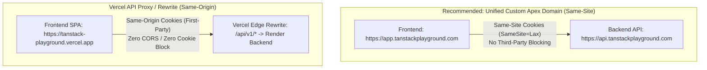

# Security Review & Threat Mitigation — TanStack Playground

## 1. Executive Summary

The **TanStack Playground** security model is designed around two non-negotiable boundaries:
1. **Zero-Trust Browser Sandbox**: Student-authored code must run with zero risk to the host application, parent DOM, host credentials, or user data.
2. **Hardened Stateless API**: The Spring Boot backend guards relational data, manages cookie-based sessions, limits payload sizes, and **never executes user-supplied code**.

---

## 2. Authentication & Session Security Architecture

### 2.1 HttpOnly Cookie Policy & XSS Elimination
Storing authentication tokens in browser `localStorage` or `sessionStorage` introduces critical vulnerabilities to Cross-Site Scripting (XSS). An injected script can immediately exfiltrate tokens and compromise user accounts.

**TanStack Playground mandates `HttpOnly` and `Secure` cookies for all session state:**
- **No Client JavaScript Access**: `document.cookie` cannot inspect or extract the token.
- **Dual-Token Architecture**:
  - **Access Token Cookie (`jwt_access`)**: Short-lived (15 minutes). Contains user `id`, `email`, and `role`. Signed with HMAC-SHA256 (`HS256`). Scoped to `Path=/api/v1`.
  - **Refresh Token Cookie (`jwt_refresh`)**: Long-lived (7 days). Contains a cryptographically random UUID v4 token hash. Stored in PostgreSQL with revocation flags. Scoped to `Path=/api/v1/auth`.

---

### 2.2 Cross-Site Cookie Behavior, Browser Restrictions & Production Alternatives

#### The Cross-Site Public Suffix List (PSL) Challenge
When deployed with default free-tier domains (`https://tanstack-playground.vercel.app` and `https://api-tanstack-playground.onrender.com`), the frontend and backend reside on different registrable domains (both `vercel.app` and `onrender.com` are registered on the Public Suffix List). Therefore:
- Requests from the browser to the backend are **cross-site**.
- Cookies must specify `SameSite=None; Secure; Partitioned` for browsers to attach them in cross-site fetch requests.

#### Browser Third-Party Cookie Limitations
Modern browsers increasingly restrict or block cross-site (third-party) cookies:
- **Safari (WebKit ITP)**: Blocks third-party cookies by default.
- **Chrome**: Gradually enforcing Privacy Sandbox restrictions and partitioning unpartitioned third-party cookies.
- **Brave & Firefox**: Strict tracking protection blocks third-party cookies by default.

#### Production Solutions (Architectural Alternatives)



1. **Option A: Unified Custom Apex Domain (Recommended for Production)**:
   - Configure a custom domain (e.g., `tanstackplayground.com`).
   - Frontend: `https://app.tanstackplayground.com`
   - Backend: `https://api.tanstackplayground.com`
   - Both subdomains share the same registrable domain (`tanstackplayground.com`). Requests become **same-site**, allowing `SameSite=Lax; Secure`, which is completely immune to third-party cookie blocking.
2. **Option B: Vercel Edge API Rewrite (Recommended for Default Cloud Tiers)**:
   - In `vercel.json`, configure a reverse proxy rewrite:
     ```json
     {
       "rewrites": [
         { "source": "/api/v1/(.*)", "destination": "https://api-tanstack-playground.onrender.com/api/v1/$1" },
         { "source": "/(.*)", "destination": "/index.html" }
       ]
     }
     ```
   - All browser requests to `/api/v1/*` are treated as **first-party same-origin** calls to the frontend origin. Cookies are treated as first-party cookies with `SameSite=Lax`, completely bypassing cross-site cookie restrictions and CORS complexity.
3. **Option C: Direct Cross-Origin Fallback**:
   - Uses `SameSite=None; Secure; Partitioned` with documented user guidance for browsers with strict third-party cookie shields enabled.

---

### 2.3 Spring Security CORS Configuration

> [!WARNING]
> In Spring Security and Spring WebMvc, calling `setAllowedOrigins` with wildcard subdomains (such as `https://tanstack-playground-*.vercel.app`) causes startup failures or invalid matching in modern Spring versions. To support dynamic preview environments alongside exact domains, `setAllowedOriginPatterns` **must** be used.

```java
@Bean
public CorsConfigurationSource corsConfigurationSource() {
    CorsConfiguration configuration = new CorsConfiguration();
    
    // Explicit pattern matching for production, Vercel preview branches, and local dev
    configuration.setAllowedOriginPatterns(List.of(
        "https://tanstack-playground.vercel.app",
        "https://tanstack-playground-*.vercel.app",
        "https://*.tanstackplayground.com",
        "http://localhost:[*]"
    ));
    
    configuration.setAllowedMethods(List.of("GET", "POST", "PUT", "DELETE", "OPTIONS"));
    configuration.setAllowedHeaders(List.of(
        "Content-Type", 
        "X-Requested-With", 
        "X-CSRF-Token"
    ));
    configuration.setAllowCredentials(true);
    configuration.setMaxAge(3600L);

    UrlBasedCorsConfigurationSource source = new UrlBasedCorsConfigurationSource();
    source.registerCorsConfiguration("/api/v1/**", configuration);
    return source;
}
```

---

### 2.4 CSRF (Cross-Site Request Forgery) Defense
When using cookie authentication with `SameSite=None`, CSRF defenses are mandatory:
1. **Custom Header Requirement**: The Spring Boot API enforces that all state-modifying requests (`POST`, `PUT`, `DELETE`) must include:
   ```http
   X-Requested-With: XMLHttpRequest
   ```
   *Browser security specifications prevent cross-site `<form>` submissions or image/script tags from attaching custom HTTP headers without triggering a preflight CORS `OPTIONS` check.*
2. **CORS Origin Validation**: Spring Security's `CorsFilter` validates the `Origin` and `Referer` headers against the approved pattern list before any request reaches business logic.

---

## 3. Code Execution & Sandpack Sandbox Security

### 3.1 Sandpack Iframe Security Boundaries & Isolation Truth

> [!CAUTION]
> Combining `sandbox="allow-scripts allow-same-origin"` on an iframe hosted on the **same origin** as the parent application is dangerous. It allows an untrusted script to access `window.parent`, manipulate the host DOM, remove its own sandbox restrictions, and read host storage.

#### How Sandpack Ensures Isolation:
Sandpack does **not** host the bundler on the parent application origin. Instead:
1. **Independent Third-Party Bundler Origin**: Sandpack loads the bundler from an entirely separate origin:
   ```text
   https://sandpack-bundler.codesandbox.io (or https://<hash>.sandpack-bundler-host.codesandbox.io)
   ```
2. **Cross-Origin SOP Protection**: Because the iframe's origin is different from the host application (`tanstack-playground.vercel.app`), the browser's **Same-Origin Policy (SOP)** strictly prevents the iframe from reading:
   - Host `HttpOnly` cookies.
   - Host `localStorage` or `sessionStorage`.
   - Host DOM tree or `window.parent` properties.
3. **Role of `allow-same-origin`**: In this cross-origin context, `allow-same-origin` allows the bundler to manage its own internal IndexedDB caches and web workers on the *CodeSandbox bundler domain*, while remaining completely blocked from the host origin.

---

### 3.2 Outbound Network Requests & CORS Reality

> [!IMPORTANT]
> **CORS is NOT an Egress Firewall.**
> A common misconception is that CORS prevents an untrusted script from making network requests. In reality:
> - CORS is a browser **read-access** restriction enforced on responses, not an egress blocker.
> - An untrusted script in an iframe *can* issue outbound HTTP `GET` requests (e.g. tracking pings, downloading assets, pinging external webhooks) or trigger simple `POST` requests without CORS blocking the outbound transmission.
> - CORS merely prevents the script from reading the returned response unless the target server returns `Access-Control-Allow-Origin: *`.

#### Sandbox Egress Mitigation Strategy
To prevent sandbox code from being used for network abuse:
1. **Content Security Policy (CSP)**: The preview iframe operates under a strict CSP:
   ```http
   Content-Security-Policy: default-src 'self'; script-src 'self' 'unsafe-eval' 'unsafe-inline' https://sandpack-bundler.codesandbox.io; connect-src 'self' https://sandpack-bundler.codesandbox.io https://*.codesandbox.io https://esm.sh https://cdn.jsdelivr.net; img-src 'self' data: https:;
   ```
2. **Synthetic Mock Network Harness**: For lessons requiring network activity (such as TanStack Query), all requests are intercepted in-memory by synthetic mock functions, avoiding actual external network traffic.
3. **No Credential Propagation**: All fetch calls inside the iframe execute with `credentials: 'omit'`, ensuring host session cookies are never transmitted on external requests.

---

### 3.3 Runaway Scripts & Host Freezing Recovery
- **Isolated Threading**: The iframe runs its own event loop. Infinite loops (`while(true){}`) will freeze the iframe, but modern browsers keep the parent host UI responsive.
- **Watchdog & Reload Action**: The host UI provides a "Restart Runner" action that forcefully unmounts the iframe, terminates its thread, and mounts a fresh Sandpack container.

---

## 4. Backend Request Limits & Injection Prevention

### 4.1 JSON Request Body Size Enforcement

> [!WARNING]
> `spring.servlet.multipart.max-request-size` only applies to `multipart/form-data` uploads. It has zero effect on `application/json` REST payloads.

To strictly enforce the **500 KB** payload limit on JSON requests:
1. **Tomcat Post Size Limit (`application.yml`)**:
   ```yaml
   server:
     tomcat:
       max-http-form-post-size: 524288 # 512 KB
       max-swallow-size: 524288
   ```
2. **Jackson Stream Constraint Bean**:
   ```java
   @Bean
   public Jackson2ObjectMapperBuilderCustomizer jacksonCustomizer() {
       return builder -> builder.postConfigurer(objectMapper -> {
           objectMapper.getFactory().setStreamReadConstraints(
               StreamReadConstraints.builder().maxStringLength(524288).build()
           );
       });
   }
   ```
3. **Payload Filter & Bean Validation**: A servlet filter rejects any request where `Content-Length > 524288` with HTTP 413 (Payload Too Large), and `@Size(max = 25)` validates the maximum number of virtual files.

---

### 4.2 Strengthened Virtual File Path Validation
To prevent directory traversal attacks in saved code payloads:
- File paths must match the hardened regular expression:
  ```regexp
  ^/(?!.*\.\.)(?!.*//)[a-zA-Z0-9_\-\.]+(/[a-zA-Z0-9_\-\.]+)*$
  ```
- **Rejection Rules**:
  - Rejects any traversal segment containing `..`.
  - Rejects double slashes `//`.
  - Rejects null bytes, whitespace, and leading/trailing slashes.
  - Limits total path length to 255 characters.

### 4.3 Database Injection Prevention
- All queries executed through Spring Data JPA with typed parameters (Hibernate 6 parameterized SQL).
- Passwords encrypted with `BCryptPasswordEncoder(12)`.
- Neon PostgreSQL connections enforce TLS (`sslmode=require`).
